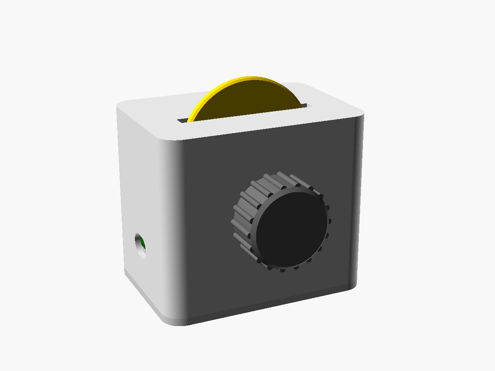
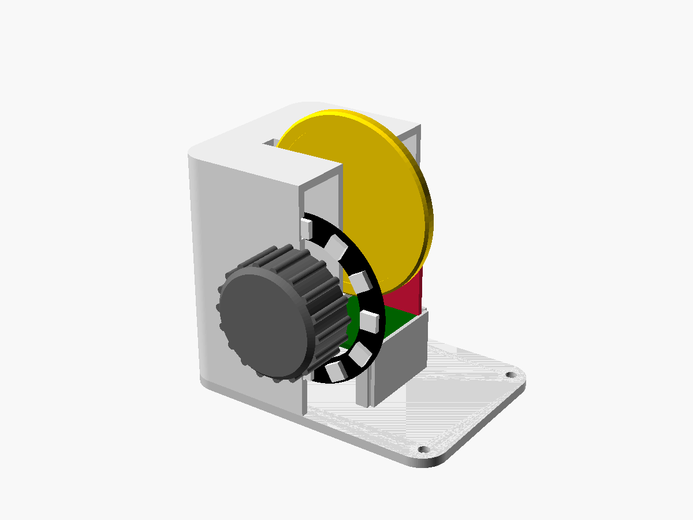
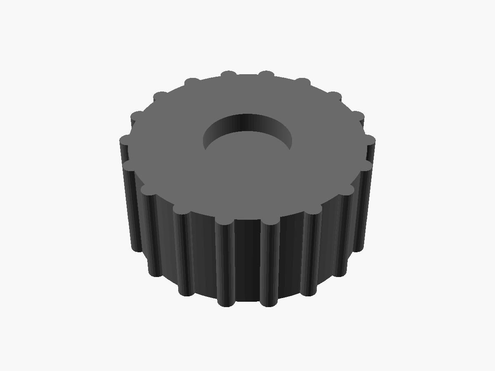

# Kids Disc Player

A screen-free music player for small kids. Drop a 3D-printed disc into the slot
and the Sonos speaker in their room starts playing that disc's album, playlist
or song. Pull the disc out and it pauses. Put the same disc back and it resumes.

```
 disc (NTAG215 sticker holding a Spotify link)
   │  NFC
   ▼
 PN532 reader ──I²C── ESP32 ──Wi-Fi, local UPnP/SOAP──▶ Sonos speaker ──▶ Spotify
```

- **No cloud service, no app, no accounts on the device.** The ESP32 talks to
  the speaker directly on the home network (port 1400), the same local API that
  [SoCo](https://github.com/SoCo/SoCo) and Home Assistant use. The only internet
  traffic is a firmware update check against this repo's GitHub releases at boot.
- **Set up from a phone, updated remotely.** One firmware build works in any
  home: Wi-Fi and the Sonos room are entered on the device's setup page, and
  new releases install themselves on the next power-up.
- **The disc carries its own link.** Each tag stores a Spotify URL as a
  standard NDEF record, so you never reflash the firmware to add a disc. Write a
  new one with any NFC phone app.
- **Both sides work, any rotation.** The tag sits in the centre of the disc.

## The design

| | |
|---|---|
|  |  |
| The player: disc in the slot, volume knob on the front | Cutaway: NFC reader (red) behind the slot, ESP32 (green) on the base, LED ring behind the knob |
|  |  |
| Disc, front: recess for a picture sticker | Knob, underside: D-shaft bore and nut recess |

Printable STLs are in [`cad/stl/`](cad/stl). Click one on GitHub to turn it in
3D. They're generated from the OpenSCAD sources in `cad/`. After changing
those, run `tools/render_previews.sh` and commit the result. CI fails a PR
that changes the CAD without updating the previews.

## Repository layout

| Path | Contents |
|---|---|
| `firmware/` | PlatformIO project for the ESP32 (Arduino framework) |
| `firmware/lib/discplayer/` | Hardware-free logic: NDEF parsing, Spotify links, Sonos SOAP and speaker discovery, version comparison, insert/remove state machine. Unit-tested on the host. |
| `cad/` | Parametric OpenSCAD models: `disc.scad`, `enclosure.scad`, shared `params.scad` |
| `docs/` | [Build guide](docs/build.md), [making discs](docs/discs.md), [setup guide for the household](docs/setup.md) |
| `cad/stl/`, `cad/preview/` | Generated: printable STLs and the pictures above |
| `tools/` | `render_previews.sh` regenerates the STLs and pictures; `gen_root_cas.sh` regenerates the CA certificates the updater trusts |

## Bill of materials (about $18 plus filament)

| Part | Notes |
|---|---|
| ESP32 DevKit (38-pin DevKitC or 30-pin DevKit V1) | Any classic ESP32 works; adjust `esp` in `enclosure.scad` if yours differs |
| PN532 NFC module "V3" (red/blue, 42.7 × 40.4 mm) | Must support I²C (DIP switches) |
| EC11 rotary encoder with push switch, 6 mm D-shaft, 20 mm shaft length | The volume knob |
| WS2812 ring, 12 LEDs, 50 mm outer diameter | Volume gauge and status light |
| 330 Ω resistor | Optional, in the LED ring's data line |
| NTAG215 or NTAG213 round stickers, 25 mm | One per disc |
| 4–6 female-female jumper wires | |
| 4 × M3 × 10 self-tapping screws | Or M3 heat-set inserts (set `pilot_d = 4.0`) |
| USB cable and 5 V phone charger | |

## Quick start

1. **Print** `cad/enclosure.scad` (shell and base) and some `cad/disc.scad`.
   See [docs/build.md](docs/build.md).
2. **Wire** the PN532 to the ESP32 over I²C. See [docs/build.md](docs/build.md#wiring).
3. **Flash once over USB** with [PlatformIO](https://platformio.org/install/cli):
   ```bash
   cd firmware && PLATFORMIO_BUILD_FLAGS=-DFIRMWARE_VERSION_RAW=v0.0.0 pio run -e esp32dev -t upload
   ```
   Version `v0.0.0` is older than any release, so on its first boot with Wi-Fi
   the device installs the latest release by itself. That tests the update
   path at home, before the device leaves. A plain `pio run -e esp32dev -t upload`
   gives a `dev` build, which never updates itself. Use that one for tinkering.
4. **Set it up** from a phone: join the `DiscPlayer-Setup` Wi-Fi network, then
   choose the home Wi-Fi and enter the Sonos room name. See [docs/setup.md](docs/setup.md).
   Spotify must be linked in the Sonos app.
5. **Make discs.** Write a Spotify link to each tag. See [docs/discs.md](docs/discs.md).

## Behaviour

| Event | What the player does |
|---|---|
| Disc inserted | Waits 0.4 s for it to settle, spins the ring while it starts the disc from the beginning at **half the max volume**, then flashes green |
| Disc removed for more than 1.5 s | Pauses, unless someone has since played something else from the Sonos app (then it leaves their music alone) |
| Same disc back within 10 min | Resumes where it stopped, or starts over if the speaker has played something else in between |
| Disc pulled in and out quickly | Nothing: too short to start, or too short to count as removed |
| Different disc | Starts the new one |
| End of the disc | Stops (repeat and shuffle are turned off when a disc starts) |
| Knob turned | Changes the volume in steps of 2, never above the max; the ring shows the level as a fraction of the max, and the top LED blinks red at the cap |
| Knob held 5 s | **Parent function:** the speaker's current volume becomes the new max (white flashes). See below |
| Blank disc, or speaker unreachable | Ring flashes red; nothing else changes |

When nothing is happening, the ring is off, because the player lives in a bedroom.

### Setting the max volume

Holding the knob for 5 s saves the speaker's **current** volume as the max.
The knob itself can't go above the max, so a toddler holding the knob can
only ever lower it. To raise it:

1. Turn the speaker up in the Sonos app, or with its own buttons.
2. Hold the knob for 5 s, until the ring flashes white.

Max volumes below 5 are rejected. The max can also be set on the setup page.
The knob's cap doesn't stop the Sonos app or the speaker's buttons. For a
hard limit, also set **Settings → System → [room] → Volume Limit** in the
Sonos app.

Pins and timings are in `firmware/include/board.h`.

## Releasing and remote updates

```bash
git tag v1.2.0 && git push origin v1.2.0
```

CI builds the firmware with that version baked in and publishes `firmware.bin`
and `version.txt` as the latest GitHub release. At every boot, a device running
a release build compares its version with `version.txt`. If the release is
newer, it downloads the image over HTTPS, writes it to its spare app slot,
verifies it, and restarts into it. Unplugging and replugging the device is
enough to update it.

Rules that keep a device in another city reachable:

- **Test every release on a second device at home first.** The update check
  runs right after Wi-Fi connects, before the NFC and Sonos code, so a release
  that crashes later in startup can still be replaced. A release that breaks
  Wi-Fi or the updater itself cannot be fixed without USB.
- **Versions only go up.** A device never installs an older version. To roll
  back, release the old code under a higher version number.
- **Don't change the partition table** (`board_build.partitions`) in a
  release. That only works over USB.
- **Update failures are harmless.** If GitHub is unreachable, or the download is
  interrupted, the device keeps running its current firmware and tries again on
  the next boot.

## Development

```bash
cd firmware
pio test -e native     # unit tests for lib/discplayer, no hardware needed
pio run -e esp32dev    # compile firmware
```

CI runs both on every push and exports STLs for every CAD part as build artifacts.

## Known limitations and risks

- **Not yet tested end to end on hardware.** The logic is unit-tested, and the
  Sonos URIs and metadata match SoCo's `ShareLinkPlugin` byte for byte (the
  tests check this). The PN532 timing and the CAD fit still need a first real build.
- **The Sonos local API is undocumented.** Sonos has kept it stable for years,
  and Home Assistant depends on it, but they could change it.
- **One speaker, found by room name.** The device looks the room up on each
  boot, and again after a failed command, so the speaker's IP may change. With
  `SONOS_UNGROUP` on (the default), the speaker leaves any group before
  playing, because Sonos only accepts commands on a group's coordinator.
- **The setup network is open (no password).** Anyone in Wi-Fi range while it
  is up could join it and read the Wi-Fi password being typed in. It only
  appears when the device needs setting up, and closes after 5 minutes.
- **Updates trust whoever controls this GitHub repo.** Turn on two-factor
  authentication for the account.
- **"Is the speaker still playing our disc?" is a heuristic.** It compares
  the queue's length and first track with what the disc put there. If someone
  replaces the queue with exactly the same album, the device can't tell the
  difference. Not yet verified against a real speaker.
- **Spotify only.** Short `spotify.link/...` URLs are not supported, because
  they need an HTTP redirect to resolve. Use the full `open.spotify.com` link.
  Artist pages can't be queued.

## License

[MIT](LICENSE). Covers the firmware, CAD models and docs.
